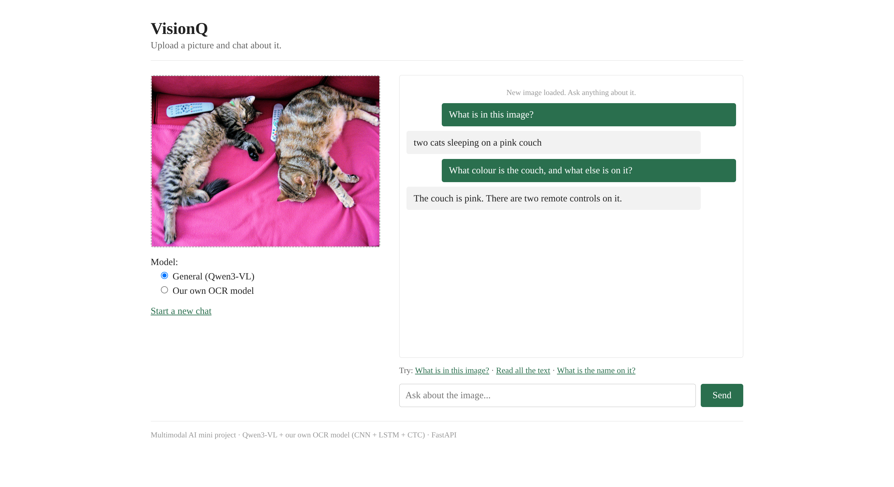
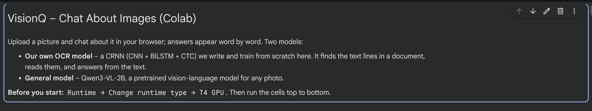
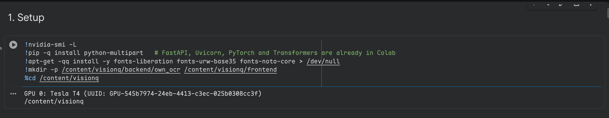
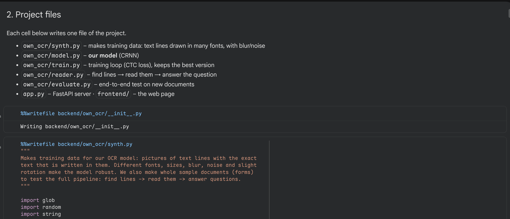
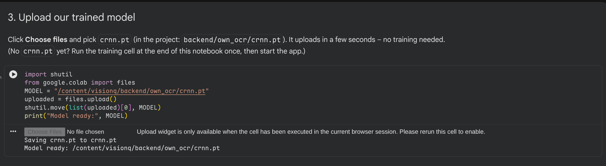
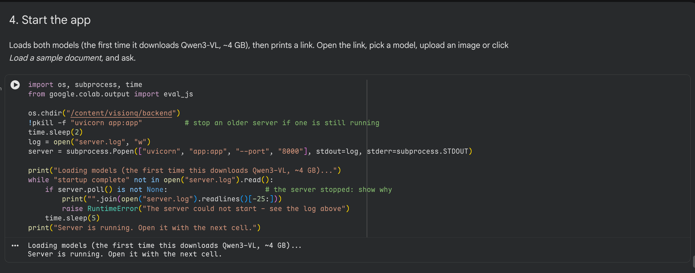
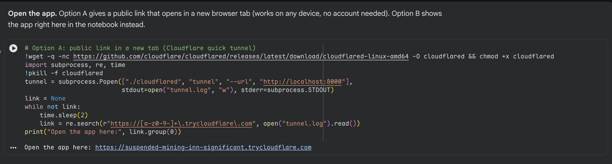
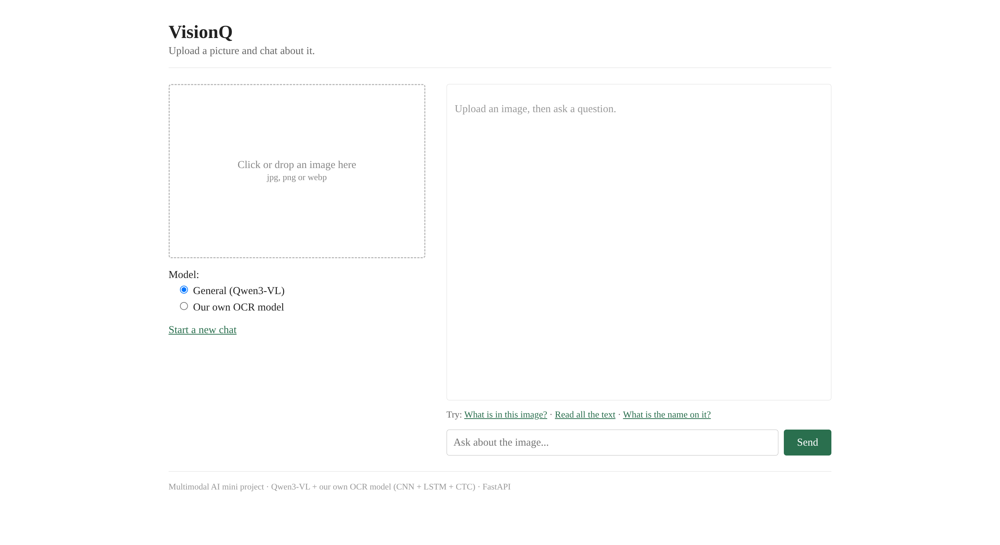
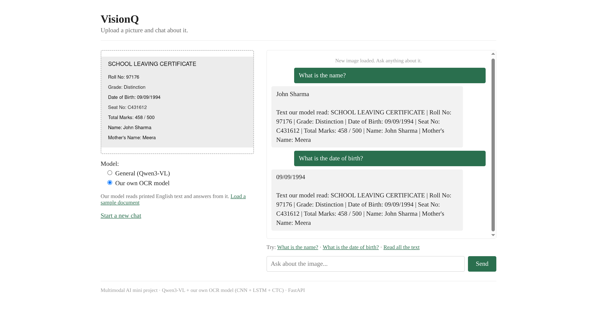
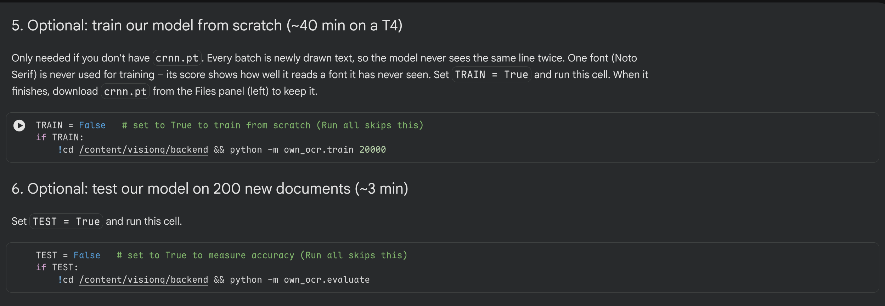

# DS Mini Project – VisionQ: Chat About Images

[](https://colab.research.google.com/drive/1UXbLkhPKI3EgV-mGk8nOEVdsMbj_AEI9)

**Colab notebook:** https://colab.research.google.com/drive/1UXbLkhPKI3EgV-mGk8nOEVdsMbj_AEI9

VisionQ is a small **multimodal AI** web app: you upload a picture and chat about it –
*"What is the name on this certificate?"*, *"What is in this photo?"*, then follow-up
questions. Answers appear word by word. The model has to understand both the **image**
and the **text question**.

The whole project (backend, frontend and model training) runs inside one Google Colab
notebook on a free T4 GPU – nothing has to be installed on your computer.



---

## What the project does

You can pick one of two models in the app:

| Model | What it is | Good for |
|---|---|---|
| **General (Qwen3-VL-2B)** | A pretrained vision-language model | Any photo or document, follow-up questions |
| **Our own OCR model** | A CRNN (CNN + BiLSTM + CTC) written and trained **from scratch** in PyTorch | Printed English documents (certificates, forms, mark sheets) |

### How it works

```
Browser ──(image + question + chat so far)──► FastAPI server (app.py) ──► chosen model
   ▲                                                                          │
   └────────────────── answer, streamed word by word ◄────────────────────────┘
```

1. The web page (`frontend/`) sends the image, the question and the earlier messages to `/api/chat`.
2. The FastAPI server (`backend/app.py`) opens the image and passes everything to the chosen model.
3. The answer is streamed back and shown as it is being written.

**General model:** the image (scaled to about 1024×1024 so small text stays readable) and
the whole conversation are given to Qwen3-VL. A short instruction tells it to copy names,
numbers and dates exactly, and to say so if something is not visible.

**Our own OCR model** works in three steps:

```
image ─► 1. find text lines ─► 2. read each line (CRNN) ─► 3. match question to "Label: value"
```

1. **Find lines** – image processing: separate dark text from the paper (Otsu threshold);
   rows that contain ink become text lines.
2. **Read lines** – our CRNN: a **CNN** turns the line image into a sequence of features,
   a **BiLSTM** reads them left↔right, and **CTC** loss turns that into text. With CTC we
   never have to label where each letter is – only what the whole line says.
3. **Answer** – keywords from the question are matched to labels such as `Name:` or
   `Date of Birth:`, and the value after the label is returned.

### Files created by the notebook

| File | Job |
|---|---|
| `own_ocr/synth.py` | Makes training data: text lines drawn in 19 fonts with blur, noise and tilt |
| `own_ocr/model.py` | The CRNN model (~0.9 M parameters) |
| `own_ocr/train.py` | Training loop with CTC loss; keeps the best version (`crnn.pt`) |
| `own_ocr/reader.py` | Find lines → read them → answer the question |
| `own_ocr/evaluate.py` | End-to-end test on 200 new documents |
| `app.py` | FastAPI server |
| `frontend/` | The web page (`index.html`, `style.css`, `script.js`) |
| [`crnn.pt`](crnn.pt) | **In this repo:** the trained weights of our OCR model |

### Results (our own OCR model)

Trained on a Colab T4 GPU for 20,000 steps (~40 min). Every batch is freshly generated,
so the model never sees the same line twice. One font (Noto Serif) is kept out of
training to test how well it reads a font it has never seen.

| Test | Result |
|---|---|
| Characters read correctly (fonts it trained on) | 99.94% |
| Characters read correctly (a font it **never** saw) | 99.99% |
| Questions answered exactly right on 200 new documents | **99.9%** (1399/1400) |
| Time per question | ~0.15 s |

**Limits:** it reads printed English only – no handwriting, no Hindi/Marathi – and tilted
phone photos with glare are hard. That is what the general model is for.

**Tech stack:** Python · PyTorch · Hugging Face Transformers (Qwen3-VL-2B) · FastAPI ·
Uvicorn · HTML/CSS/JavaScript · Google Colab (T4 GPU) · Cloudflare quick tunnel

---

## How to run (step by step)

### Step 0 – Open the notebook and pick a GPU

Open the [Colab notebook](https://colab.research.google.com/drive/1UXbLkhPKI3EgV-mGk8nOEVdsMbj_AEI9)
(sign in with a Google account). Then go to **Runtime → Change runtime type → T4 GPU →
Save**. Run the cells **from top to bottom** (click ▶ on each cell, or press
`Shift + Enter`).



### Step 1 – Setup

Checks that the GPU is available, installs the one missing package and creates the
project folders. You should see `GPU 0: Tesla T4`.



### Step 2 – Write the project files

Each cell in section 2 writes one file of the project with `%%writefile`. Run them all;
each one prints `Writing backend/...`.



### Step 3 – Upload the trained OCR model

First download [`crnn.pt`](crnn.pt) from this repo (the trained weights of our OCR
model, 3.5 MB – click the file, then the download button). Run the cell, click
**Choose Files** and pick `crnn.pt`. It prints `Model ready`. No `crnn.pt`? Run the optional training cell in
Step 6 once instead.



### Step 4 – Start the app

Starts the FastAPI server and loads both models. The first time, it downloads Qwen3-VL
(about 4 GB), so this takes a few minutes. Wait for `Server is running`.



### Step 5 – Open the app

**Option A** prints a public link (`https://….trycloudflare.com`) – click it to open the
app in a new tab; it works on any device. **Option B** shows the app inside the
notebook instead.



### Step 6 – Use the app

The app opens like this:



1. Choose a model: **General (Qwen3-VL)** or **Our own OCR model**.
2. Click the box to upload an image (jpg, png or webp) – or, with our own model, click
   **Load a sample document**.
3. Type a question and press **Send**. Ask follow-up questions in the same chat;
   click **Start a new chat** to begin again.

**Our own OCR model** on a sample certificate – it shows the answer and the text it read:



**General model** on a photo, with a follow-up question:


### Optional – Train and test the OCR model yourself

Section 5 trains the CRNN from scratch (~40 min on a T4): set `TRAIN = True` and run the
cell, then download `crnn.pt` from the Files panel to keep it. Section 6 tests the model
on 200 new documents (~3 min): set `TEST = True` and run the cell.



---

## Notes

- A free Colab session disconnects after some idle time. If the link stops working, run
  Step 4 and Step 5 again (and Step 1–3 if the runtime was reset).
- The public link changes every time Step 5 is run.
